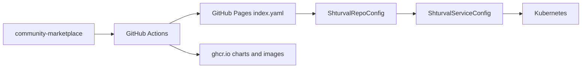

<p align="center">
  <a href="https://shturval.tech" title="Платформа Штурвал">
    
  </a>
</p>

<p align="center">
  <a href="https://shturval-tech.github.io/community-marketplace/security/">
    
  </a>
</p>

<p align="center">
  <a href="https://shturval-tech.github.io/community-marketplace/security/"><strong>Отчёт сканирования</strong></a>
  ·
  <a href="https://github.com/shturval-tech/community-marketplace/actions/workflows/security-scan.yaml">Security Scan</a>
</p>

# Shturval Community Marketplace

Community Helm-репозиторий для [Штурвала](https://shturval.tech): обёртки над upstream-чартами, зеркала образов и примеры **ShturvalServiceConfig (SSC)**. Термины — [docs/glossary.md](docs/glossary.md).

## С чего начать

| Задача | Куда идти |
|--------|-----------|
| Подключить каталог чартов в кластере | [Быстрый старт](#быстрый-старт) ниже |
| Установить сервисы **без интернета** | [docs/airgap.md](docs/airgap.md) |
| Посмотреть уязвимости образов | [Отчёт на Pages](https://shturval-tech.github.io/community-marketplace/security/), [docs/security-scanning.md](docs/security-scanning.md) |
| Добавить или изменить чарт | [CONTRIBUTING.md](CONTRIBUTING.md) |

## Как это работает

1. В кластере создаётся **ShturvalRepoConfig** с URL index (GitHub Pages) или вашего Nexus/Harbor.
2. Чарты появляются в UI: **Сервисы и репозитории → Доступные чарты**.
3. Установка — через SSC (`ShturvalServiceConfig`).



| Канал | URL |
|-------|-----|
| Helm index (для UI) | `https://shturval-tech.github.io/community-marketplace/index.yaml` |
| OCI charts | `oci://ghcr.io/shturval-tech/community-marketplace` |
| Образы | `ghcr.io/shturval-tech/community-marketplace/<image>` |

Первичная настройка GitHub: [docs/manual-setup.md](docs/manual-setup.md). CI: [docs/ci.md](docs/ci.md).

## Быстрый старт

**Нужно:** `kubectl` с доступом к кластеру Штурвала.

1. Подключите репозиторий чартов:

```bash
kubectl apply -k deploy/repoconfig/base
```

2. Проверьте:

```bash
kubectl get shturvalrepoconfig community
```

В UI Штурвала должны появиться чарты в **Доступные чарты**.

3. Пример — CloudNativePG (сначала оператор, затем кластер):

```bash
kubectl apply -f deploy/examples/ssc/cnpg-operator.yaml
kubectl apply -f deploy/examples/ssc/cnpg-cluster.yaml
```

Argo CD: `kubectl apply -f deploy/argocd/application.yaml`. Порядок установки SSC: [deploy/examples/ssc/README.md](deploy/examples/ssc/README.md).

## Каталог

### Базы данных

| Чарт | Назначение | Зависимость SSC |
|------|------------|-----------------|
| [cnpg-operator](charts/cnpg-operator/README.md) | Оператор CloudNativePG | — |
| [cnpg-cluster](charts/cnpg-cluster/README.md) | Кластер PostgreSQL | `cnpg-operator` |
| [mariadb-operator](charts/mariadb-operator/README.md) | Оператор MariaDB | — |
| [mariadb](charts/mariadb/README.md) | Экземпляр MariaDB | `mariadb-operator` |
| [redis-operator](charts/redis-operator/README.md) | Оператор Redis | — |
| [redis](charts/redis/README.md) | Экземпляр Redis | `redis-operator` |

### Очереди сообщений

| Чарт | Назначение | Зависимость SSC |
|------|------------|-----------------|
| [rabbitmq-operator](charts/rabbitmq-operator/README.md) | Оператор RabbitMQ | — |
| [rabbitmq](charts/rabbitmq/README.md) | Кластер RabbitMQ | `rabbitmq-operator` |
| [strimzi-operator](charts/strimzi-operator/README.md) | Оператор Strimzi (Kafka) | — |
| [kafka](charts/kafka/README.md) | Кластер Kafka (KRaft) | `strimzi-operator` |

### Хранилище

| Чарт | Назначение | Зависимость SSC |
|------|------------|-----------------|
| [minio-operator](charts/minio-operator/README.md) | MinIO Operator | — |
| [minio-tenant](charts/minio-tenant/README.md) | Tenant MinIO (S3) | `minio-operator` |

### Идентификация

| Чарт | Назначение | Зависимость SSC |
|------|------------|-----------------|
| [keycloak](charts/keycloak/README.md) | Keycloak (SSO, OIDC) | — |
| [authentik](charts/authentik/README.md) | authentik (IdP) | — |

### Инфраструктура

| Чарт | Назначение | Зависимость SSC |
|------|------------|-----------------|
| [proxmox-csi](charts/proxmox-csi/README.md) | CSI для Proxmox VE | — |
| [nextcloud-aio](charts/nextcloud-aio/README.md) | Nextcloud AIO | — |

## Закрытый контур

Скачайте offline-архив из [Releases](https://github.com/shturval-tech/community-marketplace/releases) (`airgap-latest` или фиксированный тег `airgap-<версия>-<дата>`), распакуйте и выполните `./push-offline.sh` во внутренние реестры. Пошагово, Harbor, типичные ошибки: [docs/airgap.md](docs/airgap.md).

## Безопасность

- **Что:** зеркала образов в GHCR — Trivy + база БДУ ФСТЭК.
- **Когда:** после каждой сборки образа; полный прогон — **ежедневно 03:00 UTC** (workflow **Security Scan**).
- **Где:** [отчёт на Pages](https://shturval-tech.github.io/community-marketplace/security/), плашка выше.
- **Пересборка бандла:** после ночного scan — workflow **Nightly Rebuild**, только если изменились исходники или upstream-образы; **новые CVE сами по себе пересборку не запускают** ([docs/ci.md](docs/ci.md)).

```bash
make scan IMAGE=ghcr.io/shturval-tech/community-marketplace/redis:latest
make scan-all
```

Подробнее: [docs/security-scanning.md](docs/security-scanning.md).

## Разработка

```bash
make lint
make package
make test
```

[docs/chart-conventions.md](docs/chart-conventions.md) · [CONTRIBUTING.md](CONTRIBUTING.md) · [AGENTS.md](AGENTS.md) (для AI-агентов)

## Лицензия

Apache License 2.0 — [LICENSE](LICENSE). Upstream-чарты и образы — по своим лицензиям.
