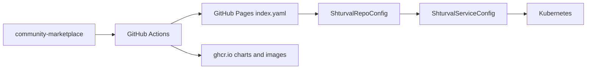

# Shturval Community Marketplace

Community Helm-репозиторий для платформы [Штурвал](https://shturval.tech): обёртки над upstream-чартами, инстансы для операторов, зеркала контейнерных образов и примеры **ShturvalServiceConfig (SSC)**.

## Как это работает

1. В кластере создаётся **ShturvalRepoConfig** с URL опубликованного index (GitHub Pages) или вашего внутреннего Nexus/Harbor.
2. Чарты появляются в UI: **Сервисы и репозитории → Доступные чарты**.
3. Установка — через SSC (`ops.shturval.tech/v1beta2`, `ShturvalServiceConfig`).



## Публикация

| Канал | URL (после настройки) |
|-------|------------------------|
| Helm index (основной для UI) | `https://shturval-tech.github.io/community-marketplace/index.yaml` |
| OCI charts | `oci://ghcr.io/shturval-tech/community-marketplace` |
| Зеркала образов | `ghcr.io/shturval-tech/community-marketplace/<image>` |

Первичная настройка GitHub (public repo, Pages, packages): [docs/manual-setup.md](docs/manual-setup.md).

## Быстрый старт в кластере

**Вариант A — манифест:**

```bash
kubectl apply -k deploy/repoconfig/base
```

**Вариант B — Argo CD:**

```bash
kubectl apply -f deploy/argocd/application.yaml
```

Пример установки CloudNativePG:

```bash
kubectl apply -f deploy/examples/ssc/cnpg-operator.yaml
kubectl apply -f deploy/examples/ssc/cnpg-cluster.yaml
```

## Каталог (первая волна)

| Чарт | Описание |
|------|----------|
| `cnpg-operator` | Оператор CloudNativePG для PostgreSQL в Kubernetes |
| `cnpg-cluster` | Кластер PostgreSQL (HA, PVC) |
| `mariadb-operator` | Оператор MariaDB/MySQL |
| `mariadb` | Экземпляр MariaDB |
| `redis-operator` | Оператор Redis (кэш, in-memory) |
| `redis` | Экземпляр Redis с репликацией |
| `rabbitmq-operator` | Оператор брокера RabbitMQ |
| `rabbitmq` | Кластер RabbitMQ (AMQP) |
| `strimzi-operator` | Оператор Strimzi для Apache Kafka |
| `kafka` | Кластер Kafka (KRaft) |
| `minio-operator` | MinIO Operator (S3 API) |
| `minio-tenant` | Tenant MinIO — объектное хранилище |
| `keycloak` | Keycloak — SSO, OIDC/SAML |
| `authentik` | authentik — IdP и SSO |
| `proxmox-csi` | CSI-тома из Proxmox VE |
| `nextcloud-aio` | Nextcloud — файловое облако |

## Закрытый контур

Сборка офлайн-бандла и загрузка во внутренние реестры:

```bash
make bundle                    # dist/: charts, index, images manifest
make push HELM_REPO_URL=https://nexus.example/helm REGISTRY=registry.example/community
```

Подробнее: [docs/airgap.md](docs/airgap.md).

## Разработка

```bash
make lint          # chart-testing lint
make package       # локальная упаковка всех чартов
make test          # lint + kind install (требует docker/kind)
```

Соглашения по чартам: [docs/chart-conventions.md](docs/chart-conventions.md).  
Участие: [CONTRIBUTING.md](CONTRIBUTING.md).  
Агенты: [AGENTS.md](AGENTS.md).

## Лицензия

Apache License 2.0 — см. [LICENSE](LICENSE). Upstream-чарты и образы подчиняются своим лицензиям.
