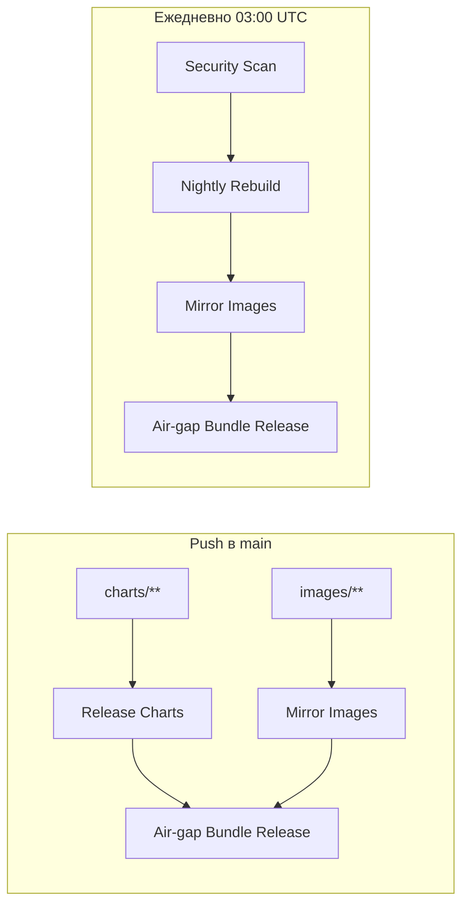

# Непрерывная интеграция (CI)

Описание автоматизации репозитория **community-marketplace**: когда что запускается и что публикуется. Настройка GitHub (Pages, права): [manual-setup.md](manual-setup.md).

## Цепочки



- **Push в `charts/**`** — обновление Helm index на GitHub Pages и OCI-чартов в GHCR.
- **Push в `images/**`** — сборка и загрузка зеркал образов в GHCR, сканирование каждого образа, публикация отчёта на Pages.
- **После успешных Release Charts или Mirror Images** — сборка offline-бандла.
- **03:00 UTC (06:00 МСК)** — полное сканирование всех `:latest`, свежая выгрузка БДУ; затем **Nightly Rebuild** при изменении отпечатка исходников.

## Workflow в GitHub Actions

| Название в Actions | Файл | Когда | Результат |
|--------------------|------|-------|-----------|
| Lint and Test Charts | `lint-test.yaml` | PR и push в `main` | lint чартов, kubeconform, ct install (kind), pytest сканирования |
| Release Charts | `release-charts.yaml` | push `charts/**` | `index.yaml` на ветке `gh-pages`, push чартов в `oci://ghcr.io/…` |
| Mirror Images | `images.yaml` | push `images/**`, вызов из Nightly Rebuild | образы в GHCR, matrix scan, SARIF, job `publish-pages` |
| Security Scan | `security-scan.yaml` | cron 03:00 UTC, вручную | полный scan `:latest`, артефакт, `publish-pages`; job `scan-gate` может завершиться с ошибкой |
| Nightly Rebuild | `nightly-rebuild.yaml` | после scheduled Security Scan, вручную | сравнение отпечатка; при изменении — Mirror Images + Air-gap Bundle |
| Air-gap Bundle Release | `airgap-bundle.yaml` | после Release Charts / Mirror Images, из Nightly Rebuild, вручную | релизы `airgap-latest` и `airgap-<ver>-<date>` |
| Publish Security Pages | `publish-security-pages.yaml` | **только вручную** | повторная публикация отчёта по `workflow_run_id` Security Scan |

Подробнее про сканирование: [security-scanning.md](security-scanning.md). Про бандл в контуре: [airgap.md](airgap.md).

## Когда пересобирается offline-бандл

Скрипт [`scripts/build-fingerprint.sh`](../scripts/build-fingerprint.sh) формирует `build-fingerprint.txt`:

- дерево git `charts/` и `images/`;
- digest upstream-образов из `FROM` в каждом `images/*/Dockerfile`.

**Не входит:** результаты Trivy, список CVE, дата снимка БДУ.

**Nightly Rebuild** сравнивает новый отпечаток с файлом из релиза `airgap-latest`. Если совпадает — пересборка образов и бандла **не выполняется**, даже если в отчёте безопасности появились новые уязвимости.

При ручном запуске Nightly Rebuild можно включить **force** — пересборка без проверки отпечатка.

## Версии offline-бандла в Releases

| Тег | Назначение |
|-----|------------|
| `airgap-latest` | Постоянная ссылка на **последнюю** успешную сборку (удобно для документации и скриптов). |
| `airgap-<версия чартов>-<YYYYMMDD>` | Фиксированная сборка на дату; в Releases **хранятся 3 последних** таких тега (старые удаляются workflow). |

В assets: `airgap-bundle.tar.gz` или `part-*`, `airgap-bundle.sha256`, `build-fingerprint.txt`.

## Ручной запуск

Из репозитория с установленным [`gh`](https://cli.github.com/):

```bash
# Полное сканирование
gh workflow run security-scan.yaml -R shturval-tech/community-marketplace

# Пересборка после scan (только если изменился отпечаток)
gh workflow run nightly-rebuild.yaml -R shturval-tech/community-marketplace

# Принудительная пересборка образов и бандла
gh workflow run nightly-rebuild.yaml -R shturval-tech/community-marketplace -f force=true

# Offline-бандл без ожидания push
gh workflow run airgap-bundle.yaml -R shturval-tech/community-marketplace
```

Переменная репозитория **`SCAN_FAIL_SEVERITY`** (по умолчанию `CRITICAL`) — порог для job `scan-gate` в Mirror Images / Security Scan.
